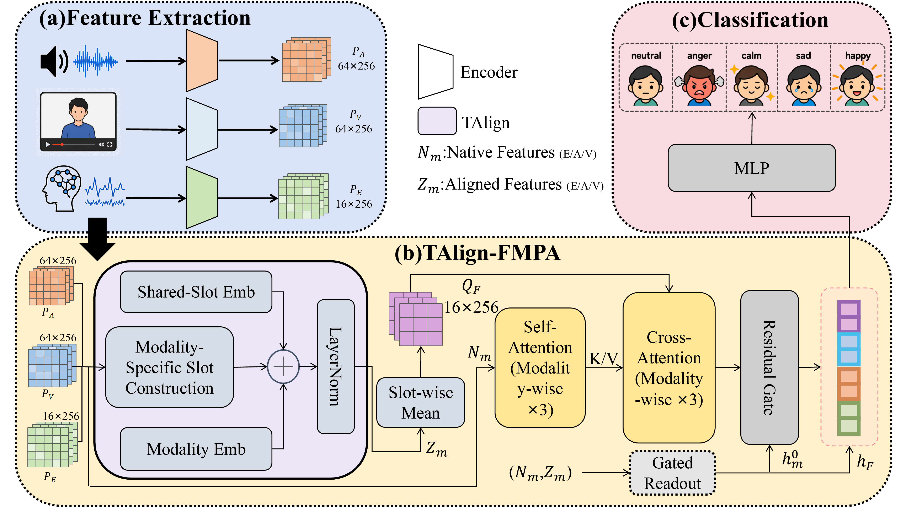

# TAlign-FMPA

**Temporal Alignment and Fusion-Guided Modality-Preserving Attention for Multimodal Emotion Recognition**

Jia Liu, Zhihui Zhou, Zhangjia Deng, Dapeng Chen, and Lina Wei

This repository contains the full-model **EAV** experiment for the TAlign-FMPA
manuscript, extracted from the research implementation
`residual_align_fmpa_v5`. It includes the model, data loader, fixed split,
training, and checkpoint evaluation. It uses pre-extracted features and does not
require the Emotion-LLaMA language-model environment.

**Status:** code extraction and local consistency checks are complete. The
scores reported in the manuscript below have **not** been reproduced by training
this standalone repository on the complete formal feature cache. This working
package contains no recordings, feature tensors, or trained weights. The
authors' release-license decision is pending; see [LICENSE_PENDING.md](LICENSE_PENDING.md).

## Architecture



TAlign groups modality features into 16 shared slots while retaining native
sequences. FMPA uses a shared fusion query to retrieve native features through
local cross-attention and updates modality representations with residual gates.
The slots provide a fixed, coarse temporal organization; the model does not
estimate sensor-clock offsets or enforce equal temporal support across modalities.

## Repository

```text
TAlign-FMPA/
  config.py                   # Frozen full-model EAV defaults
  train.py                    # Train and select by validation Macro-F1
  evaluate.py                 # Evaluate a selected checkpoint
  model/                      # TAlign, FMPA, classifier, auxiliary heads
  data/                       # Feature loading and train-only normalization
  utils/                      # Metrics, checkpoint compatibility, provenance
  splits/                     # Path-free formal split and identity provenance
  docs/FEATURES.md             # Feature contract and extraction limitations
  docs/VALIDATION.md           # Extraction and validation record
  assets/framework.png
```

PME4, DEAP, ablation variants, baseline models, and plotting scripts are outside
this release's scope. Their appearance in the manuscript does not mean they
are implemented here.

## Installation

Use an isolated Python environment, install a PyTorch build suitable for your
device, and install the remaining dependencies:

```bash
python -m pip install -r requirements.txt
```

The formal server record identifies **Python 3.10, PyTorch 2.0.0+cu117, and an
RTX 3090**. This is not a complete recovered environment lockfile. For that older
PyTorch version, use NumPy below 2 and follow the
[official PyTorch installation instructions](https://pytorch.org/get-started/previous-versions/).
The local extraction checks used PyTorch 2.11.0 on CPU. Exact random-number and
floating-point equivalence across library versions or devices is not guaranteed.

Only PyTorch, NumPy, and scikit-learn are required for training/evaluation.
Video and signal extraction libraries are not runtime dependencies.

## Data preparation

Obtain EAV separately from the dataset authors' official resources:

- [Official EAV project and data-access information](https://github.com/nubcico/EAV)
- [Official Zenodo dataset record, version 3](https://zenodo.org/records/13799131)
- [Dataset paper: Lee et al., Scientific Data, 2024](https://www.nature.com/articles/s41597-024-03838-4)

The files on Zenodo have restricted access. Follow the application instructions
on that record and obtain authorization from the dataset providers. This
repository does not redistribute EAV recordings or feature caches. The
dataset providers' pre-extracted features are not assumed to match the feature
representation used by TAlign-FMPA.

Prepare the **matching formal feature cache**, with these files directly under
each modality directory:

```text
/path/to/eav_features/
  EEG-TDE-16/<sample_id>.npy
  audio-frame-lld/<sample_id>.npy
  EVA-ViT-G-5s/<sample_id>.npy
```

| Input | Shape per window | Organization |
|---|---|---|
| EEG | 16 x 150 | 16 overlapping 2-second DE windows; 30 channels, 5 bands |
| Audio | 64 x 90 | Ordered, temporally pooled acoustic descriptors |
| Video | 64 x 1408 | 16 sampled frames, 4 spatial tokens per frame |

The label order is **neutral, anger, calm, sad, happy**. EEG and audio are
standardized using training data only; video values are not standardized.
See [docs/FEATURES.md](docs/FEATURES.md) for exact loading and normalization.

The included split contains 16,800 five-second windows from 4,200 trials and
42 subjects. Trials are split within subject and emotion before window
expansion: 10,080 training, 1,680 validation, and 5,040 test windows. All four
windows from a trial remain together. **Subjects overlap across subsets.**
This evaluates new trials of seen subjects, not unseen-subject generalization.

The public split removes recording-path columns and preserves the original
ordered sample identities, labels, and subsets. Its accompanying provenance
file records the original and sanitized hashes.

The historical cache's complete extraction provenance is not available.
Matching tensor shapes or recreating features with current extraction scripts
does not establish feature equivalence or guarantee the reported scores.

## Training

Run commands from this repository's root:

```bash
python train.py --features-root /path/to/eav_features --output-dir output/eav_seed42 --device cuda:0
```

The formal defaults are frozen: seed 42; dimension 256; classifier hidden
dimension 512; 8 attention heads; 16 slots; local radius 1; dropout 0.2;
AdamW learning rate and weight decay both 0.0001; gradient norm limit 1;
batch size 16; evaluation batch size 64; at most 60 epochs; early stopping
after 10 epochs without improvement; both auxiliary loss weights 0.1.
CUDA runs use AMP, matching the original runner.

Checkpoint selection uses the highest validation five-class Macro-F1, retaining
the earliest epoch on a tie. Test metrics are calculated after selection.
Training refuses to overwrite an existing output directory.

Outputs include:

```text
output/eav_seed42/
  best_model.pth
  train_stats.npz
  train_log.csv
  validation_predictions.csv
  test_predictions.csv
  summary.json
```

A new run records its own code, split, statistics, and environment provenance.
Using the paper's protocol does not automatically mark it as a verified
reproduction of the paper result.

For a short integration check with available feature inputs:

```bash
python train.py --features-root /path/to/eav_features --output-dir output/eav_smoke --device cpu --smoke
```

This defaults to one epoch and five samples per subset. Smoke results are
explicitly marked as development-only. The repository does not generate or
distribute synthetic feature inputs.

## Evaluation

For a checkpoint created by this repository:

```bash
python evaluate.py --checkpoint output/eav_seed42/best_model.pth --features-root /path/to/eav_features --output-dir output/eav_seed42_eval --device cuda:0
```

The checkpoint includes configuration, label order, and train-only statistics.
Evaluation needs test feature files, not training feature files, and never
recomputes normalization from evaluation data. Use a new output directory.

For your own trusted historical full-model V5 checkpoint:

```bash
python evaluate.py --checkpoint /path/to/original/best_model.pth --trusted-legacy-checkpoint --features-root /path/to/eav_features --output-dir output/eav_legacy_eval --device cuda:0
```

Historical pickle loading requires this explicit flag. Use it only for a
checkpoint whose source you trust. If that checkpoint lacks statistics,
provide its original train-only cache with `--stats-cache`. Known unused
historical parameters are discarded; missing, unexpected, or incompatible
active model parameters are rejected.

Use `python train.py --help` and `python evaluate.py --help` for path and
loading options. `--no-preload-features` reduces host-memory use.

## Reported result and verification

| Dataset / source experiment | Accuracy (%) | Macro-F1 (%) |
|---|---:|---:|
| EAV, formal full V5, seed 42 | 85.95 | 86.04 |

These are the manuscript's original formal experiment values, not a new
training result from this repository.

Local checks confirmed exact model initialization, train/eval outputs,
auxiliary outputs, gradients, and one optimizer update against the source in
the same tested CPU environment. A synthetic one-epoch train/evaluate check
also passed. The historical formal checkpoint loads and runs. Full-cache
training and full-test score reproduction remain unverified here.

The extracted model has **2,096,376 parameters including the two auxiliary
heads**, or **2,082,030 excluding those heads**. The latter corresponds to the
manuscript's approximately 2.082M main-path parameter count.

See [docs/VALIDATION.md](docs/VALIDATION.md) for the verification boundaries and
source fingerprints.

## Citation

The manuscript has no verified publication DOI in this working package.
Use its manuscript details until publication metadata is available:

```bibtex
@unpublished{liu2026talignfmpa,
  author = {Liu, Jia and Zhou, Zhihui and Deng, Zhangjia and Chen, Dapeng and Wei, Lina},
  title = {{TAlign-FMPA}: Temporal Alignment and Fusion-Guided
           Modality-Preserving Attention for Multimodal Emotion Recognition},
  year = {2026},
  note = {Manuscript}
}
```

## Attribution and release status

The relevant model and training components were extracted from the
Emotion-LLaMA-v2 research tree. Its BSD notice is retained in
[third_party/Emotion-LLaMA-v2_LICENSE.md](third_party/Emotion-LLaMA-v2_LICENSE.md).
No LLaMA weights, language-model code, baseline implementations, or raw EAV
recordings are included. The repository is publicly accessible; license
selection for the authors' contributions remains pending.
